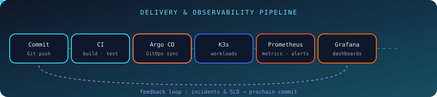
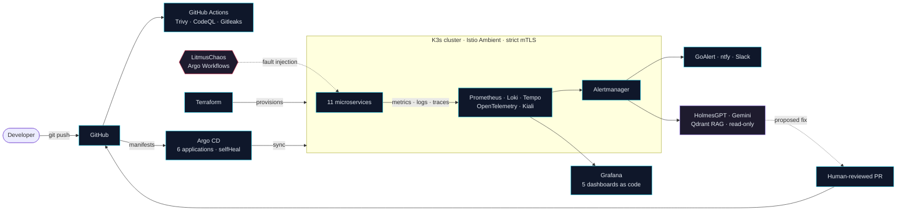
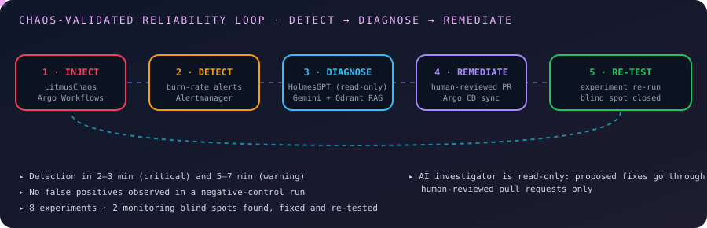
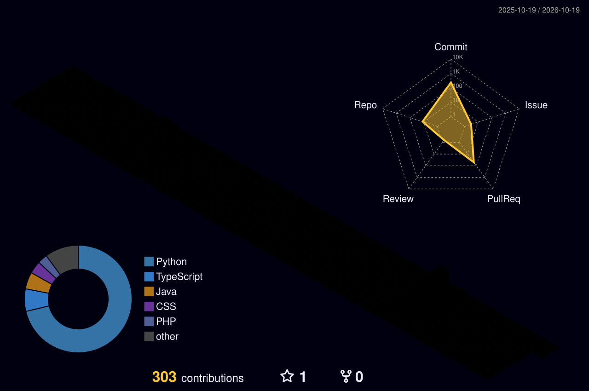

<!-- ===================== HERO ===================== -->

<div align="center">


<a href="https://git.io/typing-svg">
  
</a>

<br/>


<br/>

<a href="https://github.com/yosrtaktak/yosrtaktak/blob/main/assets/CV_Yosr_Taktak_EN.pdf">
  
</a>
<a href="https://www.linkedin.com/in/yosrtaktak">
  
</a>
<a href="mailto:yosrtaktak6@gmail.com">
  
</a>


</div>

---

## `01` · About Me

```yaml
name: Yosr Taktak
role: Software Engineering Student (final year, graduating June 2027)
focus: [Cloud, DevOps, SRE, Observability]
seeking: 6-month Cloud / DevOps / SRE internship (Feb-Apr 2027)
relocation: open to relocation in Europe
latest_work: Reliability platform on K3s (SLOs, chaos engineering, GitOps, on-call automation)
location: Sfax, Tunisia
languages: Arabic (native), French (C1), English (B2)
```

I am a final-year software engineering student at the **International Institute of Technology (IIT), Sfax**. During my DevOps/SRE internship at **BePrimeTech**, I designed and validated, through chaos experiments, a full **detect → diagnose → remediate** reliability loop on Kubernetes.

I am now looking to deepen this into production-grade Cloud engineering experience within an experienced platform or infrastructure team.

---

## `02` · Technology Stack

<div align="center">
  
  <br/><br/>
  
</div>

---

## `03` · Reliability Platform · SRE in Action

> **DevOps & SRE Internship — BePrimeTech (Jun – Aug 2026)**: production-readiness and reliability platform for an 11-microservice e-commerce application on K3s.

<div align="center">
  
</div>

### 🔁 Delivery & observability pipeline

<div align="center">
  
</div>

### 🏗️ Architecture



### 💥 Chaos-validated reliability loop

<div align="center">
  
</div>

### 🎯 SLO-based alerting

- **5 SLOs (99% – 99.95%)** defined on user-centric SLIs, measured at the mesh L7 layer
- **Multi-burn-rate alerting** following the Google SRE Workbook: 16 alerts, 8 inhibition rules, Slack routing by severity
- **Incident management:** GoAlert, ntfy, Slack war room with ChatOps, incident database
- **Hardening:** default-deny authorization policies, PodDisruptionBudgets, tuned resource limits, observability stack packaged as a single Helm chart

---

## `04` · Experience & Projects

| Period | Role | What I built |
|---|---|---|
| Jun – Aug 2026 | **DevOps & SRE Intern** · BePrimeTech | Reliability platform on K3s: SLO alerting, chaos engineering, GitOps, on-call automation |
| Feb – Jun 2025 | **Full-Stack Developer** · Collary platform | Angular 17 / Spring Boot / MySQL features for recruitment agencies and healthcare facilities |
| Feb – May 2024 | **Full-Stack Developer Intern** · IT SERV | Spring Boot microservices (Eureka, API Gateway, Config Server) for a task and timesheet platform |
| Jul – Aug 2023 | **Network Monitoring Intern** · New Engineering IT | Zabbix monitoring of Windows, Linux and web servers via agents and SNMP |

<table>
<tr>
<td width="50%" valign="top">

### 🛒 Retail ERP

Stock batch logic, audited stock movements, scheduled alerting with Firebase push, JWT roles, POS and analytics UI.

`Next.js 14` `TypeScript` `Prisma` `PostgreSQL`

</td>
<td width="50%" valign="top">

### 📈 Decision-Support Platform

Team project: automated data pipeline, analytics dashboards, sales forecasting and a local-LLM assistant.

`SQL Server` `SSIS` `SSAS` `React` `FastAPI` `Ollama`

</td>
</tr>
</table>

<div align="center">

<a href="https://github.com/yosrtaktak?tab=repositories">
  
</a>

</div>

---

## `05` · Contribution Graph

<div align="center">
  
</div>

---

<div align="center">

### Build · Automate · Observe · Improve


</div>
